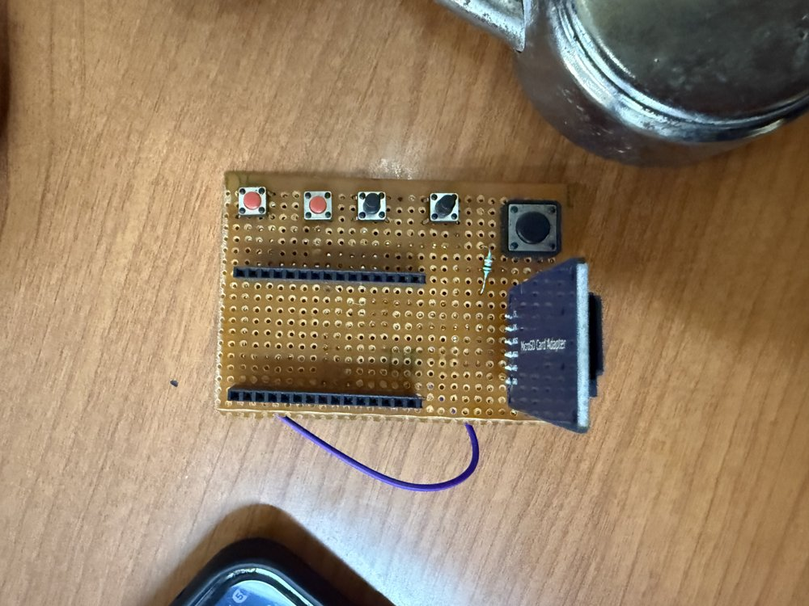
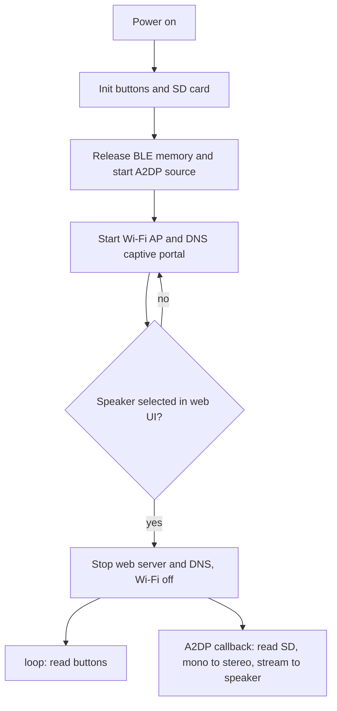

# ESP32 Bluetooth Audio Bridge

An ESP32 that plays WAV files from a microSD card to any Bluetooth speaker over **A2DP**. On boot, the ESP32 hosts a Wi-Fi **captive portal** where you scan for and pick a speaker. It then **shuts Wi-Fi off** and runs as a standalone player controlled by five push buttons.

The project was built in three iterations (cloud prototype, self-hosted portal, standalone SD player). The full write-up is in [`docs/ESP32_AudioBridge_ProjectReport.pdf`](docs/ESP32_AudioBridge_ProjectReport.pdf). This repo contains the final (Stage 3) firmware.

## Features

- Classic Bluetooth device discovery with manual parsing of Extended Inquiry Response (EIR) packets to get readable device names
- Connection management through the A2DP source library
- Self-hosted Wi-Fi access point with DNS-redirect captive portal and a small web dashboard (REST endpoints returning JSON)
- WAV playback from SD card over SPI, with in-place mono-to-stereo conversion
- Five GPIO buttons (play/pause, next, previous, volume up/down) with edge detection and debounce
- Wi-Fi and the web server are torn down after the speaker is chosen, so the radio is dedicated to Bluetooth audio

## How it works

## Hardware

- Classic ESP32 dev board (needs Classic Bluetooth, so not the S2/S3/C3 variants)
- microSD card module (SPI)
- 5 push buttons, plus 2 x 10 kΩ pull-up resistors to 3.3 V for GPIO 34 and 35
- Bluetooth speaker
- Perfboard (see photo)

| Function | GPIO | Notes |
|---|---|---|
| SD chip select | 5 | SPI on the default VSPI pins (SCK 18, MISO 19, MOSI 23) |
| Play / Pause | 25 | `INPUT_PULLUP`, button to GND |
| Next track | 34 | Input-only pin, no internal pull-up: external 10 kΩ to 3.3 V |
| Previous track | 35 | Input-only pin, no internal pull-up: external 10 kΩ to 3.3 V |
| Volume down | 32 | `INPUT_PULLUP`, button to GND |
| Volume up | 33 | `INPUT_PULLUP`, button to GND |

All buttons are active-low.

## Software and libraries

- [ESP32-A2DP](https://github.com/pschatzmann/ESP32-A2DP) (`BluetoothA2DPSource`) by Phil Schatzmann. It implements the A2DP source; this project builds device discovery, the portal UI, SD streaming and controls around it.
- ESP32 Arduino core: `WiFi`, `WebServer`, `DNSServer`, `SD`, `SPI`
- ESP-IDF Bluetooth GAP API (`esp_gap_bt_api.h`) for Classic Bluetooth inquiry
- [ArduinoJson](https://arduinojson.org/)

## SD card contents

The sketch expects **mono, 16-bit PCM, 44.1 kHz WAV files with a standard 44-byte header**, named as in the `playlist[]` array at the top of the sketch (currently 36 files named after Indian states and union territories, e.g. `/Rajasthan.wav`). Audio files are not included. To use your own tracks, edit `playlist[]`.

## Build and flash

1. Install the Arduino IDE and the ESP32 board package.
2. Install the ESP32-A2DP and ArduinoJson libraries.
3. Open `src/ESP32_Audio_Bridge/ESP32_Audio_Bridge.ino`.
4. Select an ESP32 Dev Module board and upload.
5. Change `ap_ssid` / `ap_pass` in the sketch before using it anywhere other than your desk.

## Usage

1. Power on the board and join the Wi-Fi network `ESP_Audio_Bridge`.
2. The captive portal should open. If it doesn't, browse to `192.168.4.1`.
3. Tap **Search for Speakers** (10-second scan) and tap your speaker.
4. Wi-Fi switches off. Press **Play/Pause** to start; use Next/Previous and Volume +/- as needed.

## Development stages

| Stage | Control | Wi-Fi | Audio |
|---|---|---|---|
| 1. Blynk prototype | Blynk cloud app | Station mode (hotspot) | 440 Hz test tone |
| 2. Captive portal | Browser, self-hosted | Access point | 440 Hz test tone |
| 3. Standalone (this repo) | 5 physical buttons | Off after setup | WAV files from SD |

## Engineering notes

- **Wi-Fi / Bluetooth coexistence.** The ESP32 time-shares one 2.4 GHz radio between Wi-Fi and Bluetooth. In testing, keeping Wi-Fi active while streaming made the control path unreliable, so the final design turns Wi-Fi off after setup.
- **Configuration trap.** A blocking loop at the end of `setup()` serves the portal until a speaker is chosen, then stops the web server and DNS and calls `WiFi.mode(WIFI_OFF)`.
- **Memory.** BLE controller memory is released at startup (`esp_bt_controller_mem_release`) since only Classic Bluetooth is used. The dashboard HTML is stored in flash (`PROGMEM`).
- **EIR parsing.** Inquiry results are parsed field by field (complete and shortened local name types); unnamed devices and duplicate addresses are filtered out.
- **Mono to stereo in place.** Mono samples are read into the first half of the stereo output buffer, then expanded backwards so no sample is overwritten before it is read and no extra buffer is allocated.
- **Track switching.** The audio callback runs in the Bluetooth task while buttons are handled in `loop()`. `playTrack()` clears `isPlaying` and waits 30 ms before closing and reopening the file.

## Known limitations

- The speaker is chosen through the portal on every power-up. Changing speaker means rebooting, because Wi-Fi is off afterwards.
- The playlist and the access point SSID/password are hard-coded in the sketch.
- Expects 44.1 kHz mono 16-bit WAV with a 44-byte header.
- Track switching is protected by a flag and a short delay, not a mutex.

## Report

The report in [`docs/`](docs/ESP32_AudioBridge_ProjectReport.pdf) covers all three stages with code excerpts and the problems found at each step. Screenshots of nearby Bluetooth devices have been redacted.
